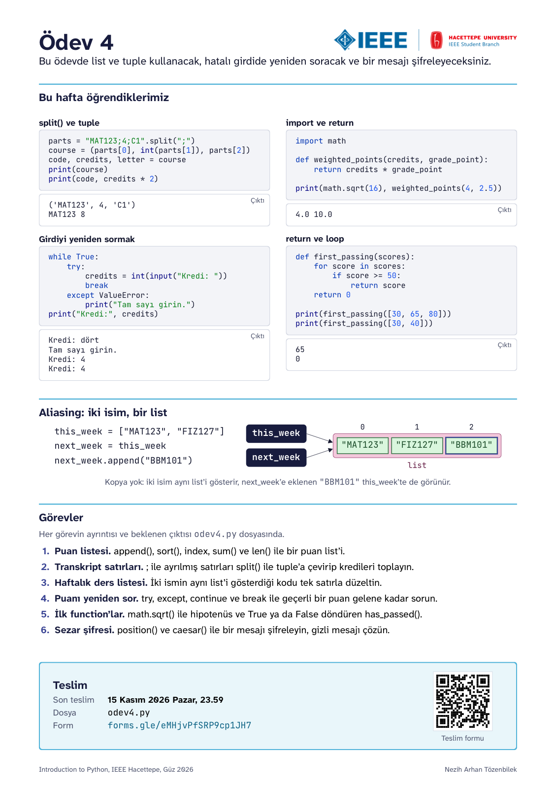
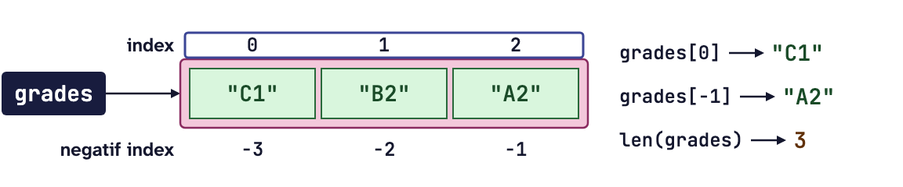
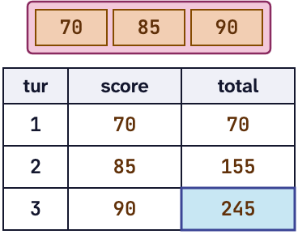
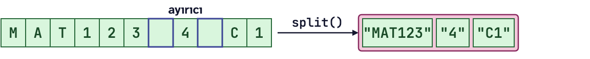
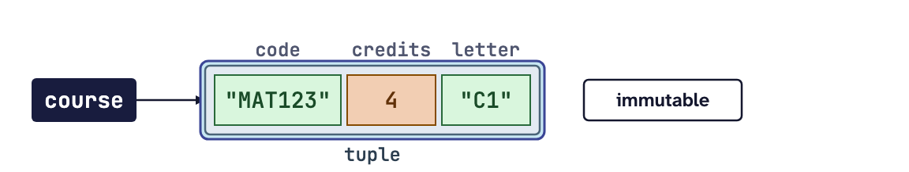
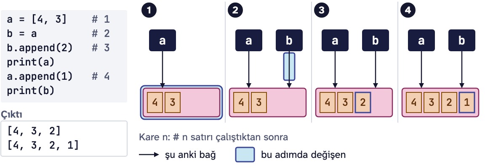
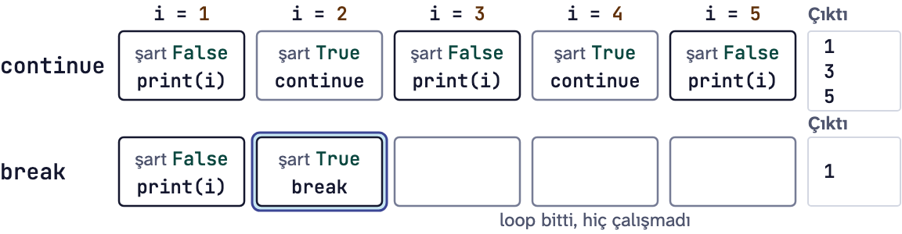
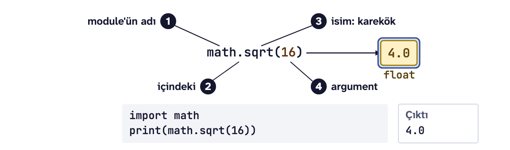
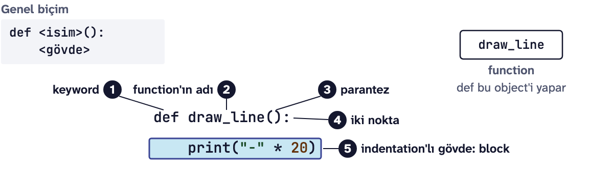
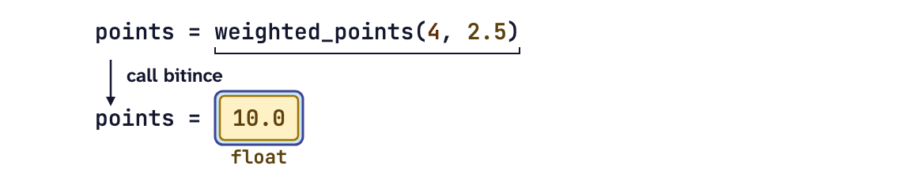

# Ödev 4: Transkript satırları

IEEE Hacettepe **Introduction to Python** dersinin 4. ödevi, Güz 2026.

<p align="center"></p>

Yukarıdaki kart bu haftanın özeti. Aşağıda aynı konuların daha ayrıntılı tekrarı var.

**İndirmek için:** yeşil **Code** düğmesine basın, **Download ZIP** deyin, zip'i açın. Git bilmenize gerek yok.

**Son teslim:** 15 Kasım 2026 Pazar, 23.59

**Teslim:** [Ödev 4 teslim formu](https://forms.gle/eMHjvPfSRP9cp1JH7)

Bu ödevin sonunda list (liste) ve tuple'larla (demetler) veri tutabilecek, iki ismin aynı list'i gösterdiği durumu fark edebilecek, hatalı girdide yeniden sorabilecek ve kendi function'larınızla (fonksiyonlar) bir mesajı şifreleyip çözebileceksiniz.

## Bu ödevde kullanacaklarımız

### List
List birçok value'yu (değer) sırayla tek bir isim altında tutar. Köşeli parantezle yazılır; içindeki her value bir item'dır (eleman).

```python
temps = [12, 9, 14]
print(temps)                     # [12, 9, 14]
print(type(temps), len(temps))   # <class 'list'> 3
```



Index (indis) str'deki gibi 0'dan başlar, -1 son item'dır. Slicing (dilimleme) ve `in` de str'deki gibi çalışır, yalnızca `in` bu kez bütün bir item arar. Tablodaki her satır `temps = [12, 9, 14]` için:

| Yazım | Ne verir | Sonuç |
|---|---|---|
| `temps[0]` | ilk item | `12` |
| `temps[-1]` | son item | `14` |
| `temps[1:]` | index 1'den sona kadar, yeni bir list | `[9, 14]` |
| `9 in temps` | bu item list'te var mı | `True` |
| `len(temps)` | item sayısı | `3` |

Son index `len(temps) - 1`, yani 2'dir. Item sayısıyla son index'i karıştırıp `temps[3]` yazarsanız `IndexError: list index out of range` alırsınız.

`+` iki list'i arka arkaya ekler, `*` bir list'i tekrarlar. İkisi de yeni bir list verir:

```python
print([1, 2] + [3])   # [1, 2, 3]
print([0] * 4)        # [0, 0, 0, 0]
```

### List üzerinde for, sum() ve len()
`for`, bir list'in item'larını sırayla tek tek verir; index'e gerek yoktur. Ders 3'teki accumulator list üzerinde de aynı çalışır:

```python
temps = [12, 9, 14]
total = 0
for t in temps:
    total += t
print(total)   # 35
```



Counter (sayaç) da böyle çalışır: loop'un (döngü) içine bir `if` koyup şartı sağlayan item'ları sayarsınız.

`sum()` toplamı, `len()` item sayısını verir. İkisiyle ortalamayı bulup Ders 2'deki `:.2f` ile iki basamakla yazabilirsiniz:

```python
temps = [12, 9, 14]
average = sum(temps) / len(temps)
print(average)            # 11.666666666666666
print(f"{average:.2f}")   # 11.67
```

Sık yapılan hata, `total = 0` satırını loop'un içine yazmaktır. O zaman total her adımda sıfırlanır ve elinizde yalnızca son item kalır.

### List'i değiştirmek
List mutable'dır (değiştirilebilir): oluşturduktan sonra içi değişebilir. Bir item'a yeni bir value atamak da buna dahil:

```python
temps = [12, 9, 14]
temps[1] = 10
print(temps)   # [12, 10, 14]
```

![Item assignment: grades[0] = "B1"](img/ders4-item-assign.png)

Aşağıdaki method'lar (metotlar) yeni bir list yapmaz, aynı list'i yerinde değiştirir. Her satır `temps = [12, 9, 14]` ile başlıyor:

| Satır | Ne yapar | Sonra `temps` |
|---|---|---|
| `temps.append(7)` | 7'yi sona ekler | `[12, 9, 14, 7]` |
| `temps.insert(1, 7)` | 7'yi index 1'e koyar, sonrakiler bir sağa kayar | `[12, 7, 9, 14]` |
| `temps.remove(9)` | value'su 9 olan ilk item'ı siler | `[12, 14]` |
| `last = temps.pop()` | son item'ı çıkarır ve onu geri verir: `last` 14 olur | `[12, 9]` |
| `temps.sort()` | küçükten büyüğe sıralar | `[9, 12, 14]` |

Boş bir list'le başlayıp loop'ta `append()` ile doldurmak çok kullanılan bir kalıptır:

```python
squares = []
for i in range(1, 4):
    squares.append(i * i)
print(squares)   # [1, 4, 9]
```

Üç şeye dikkat edin:

- `sort()`'un sonucunu bir isme atamayın: `temps = temps.sort()` yazarsanız sıralı list'i kaybedersiniz; nedenini Ders 5'te göreceğiz.
- `sort()` harfleri Unicode numarasına göre dizer: Ç, İ, Ö, Ş ve Ü, Z'den sonra gelir. `["Zehra", "Ömer", "Batu"]` sıralanınca `['Batu', 'Zehra', 'Ömer']` olur.
- `remove()` list'te olmayan bir value'yu silemez: `ValueError: list.remove(x): x not in list`.

### split() ve type conversion (tip çevirimi)
`split()` bir str'yi parçalara bölüp bir list verir. Parantezin içine yazdığınız ayırıcıdan böler; parantezi boş bırakırsanız boşluklardan böler. Asıl str değişmez.

```python
print("Ali Emre Batu".split())   # ['Ali', 'Emre', 'Batu']
date = "15.11.2026"
parts = date.split(".")
print(parts)                     # ['15', '11', '2026']
```



Parçaların hepsi str'dir, içlerinde rakam olsa bile. Sayı gibi kullanmak için Ders 2'deki `int()` ile çevirin:

```python
print(parts[2] * 2)        # 20262026
print(int(parts[2]) + 1)   # 2027
```

İlk satır hata vermiyor ama yanlış: str'yi iki kez arka arkaya yazdı. Çevirmeden toplamaya kalkarsanız da `parts[2] + 1` satırı `TypeError: can only concatenate str (not "int") to str` verir.

### Tuple
Tuple, alanları sabit bir kayıttır. Parantezle yazılır ve oluşturulduktan sonra değiştirilemez, yani immutable'dır (değişmez). Index ve `len()` list'teki gibi çalışır.

```python
ticket = ("Ankara", "Eskişehir", 14)
print(ticket[0], ticket[-1], len(ticket))   # Ankara 14 3
print(type(ticket))                         # <class 'tuple'>
```



Bir item'ına yeni value atanamaz: `ticket[2] = 15` satırı `TypeError: 'tuple' object does not support item assignment` verir. Koltuk değişirse yeni bir tuple yazarsınız. Tek item'lık bir tuple'da virgül şarttır: `("Ankara",)`.

| | list | tuple |
|---|---|---|
| Yazımı | `[12, 9, 14]` | `("Ankara", "Eskişehir", 14)` |
| Değiştirilebilir mi | evet, mutable | hayır, immutable |
| Ne zaman | çoğalıp değişen benzer item'lar | alanları sabit tek bir kayıt |

Bir tuple'ı list'e eklerken tuple'ın kendi parantezini unutmayın, çünkü `append()` tek bir value alır:

```python
trips = []
trips.append(("Ankara", "Konya", 3))
print(trips)   # [('Ankara', 'Konya', 3)]
```

İç parantez olmadan `trips.append("Ankara", "Konya", 3)` yazarsanız `TypeError: list.append() takes exactly one argument (3 given)` alırsınız.

### Unpacking
Unpacking, bir tuple'ın item'larını tek satırda ayrı isimlere atar. İsim sayısı item sayısına eşit olmalıdır:

```python
ticket = ("Ankara", "Eskişehir", 14)
start, end, seat = ticket
print(seat, start)   # 14 Ankara
```

`start, end = ticket` yazarsanız `ValueError: too many values to unpack (expected 2, got 3)` alırsınız. Kullanmayacağınız bir alan olsa da ona bir isim verin.

Tuple'lardan oluşan bir list'i dolaşırken `for` satırı her tuple'ı kendisi açar:

```python
friends = [("Zehra", 20), ("Emre", 22)]
for name, age in friends:
    print(f"{name}, {age} yaşında")
```

```text
Zehra, 20 yaşında
Emre, 22 yaşında
```

### Object, reference ve aliasing
Python'da her value bir object'tir (nesne). İsim object'i içinde tutmaz, onu gösterir; bu oka reference (referans) denir. `b = a` yeni bir list yapmaz, aynı list'e ikinci bir isim verir. Buna aliasing denir: list'i bir isim üzerinden değiştirirseniz değişiklik öteki isimden de görünür.

```python
cart = ["ekmek", "süt"]
basket = cart
basket.append("peynir")
print(cart)   # ['ekmek', 'süt', 'peynir']
```



Ayrı bir list istiyorsanız `copy()` kullanın. copy() yeni bir list yapar; birindeki değişiklik ötekine geçmez:

```python
cart = ["ekmek", "süt"]
basket = cart.copy()
basket.append("peynir")
print(cart, basket)   # ['ekmek', 'süt'] ['ekmek', 'süt', 'peynir']
```

`==` value'ları kıyaslar, buna equality (eşitlik) denir. `is` iki ismin aynı object'i gösterip göstermediğini sorar, buna da identity (kimlik) denir.

```python
a = [4, 3]
b = a
c = a.copy()
print(a == b, a is b)   # True True
print(a == c, a is c)   # True False
```

Aliasing'in sürprizi yalnızca mutable object'lerde görünür. int, str ve tuple immutable'dır: `x = x + 1` gibi bir satır eski object'i değiştirmez, yeni bir object yapar ve ismin okunu ona taşır. Ders 4'ün ana cümlesi de buydu: isim bir object'i gösterir; bir satır ya object'i değiştirir ya da ismin okunu taşır.

### try ve except
Program çalışırken çıkan hataya exception (sıra dışı durum) denir; adını traceback'in (yığın izi) son satırı söyler. `try` riskli satırları çalıştırır, `except` adı verilen exception'ı yakalar:

```python
text = "3,5"
try:
    number = int(text)
    print("Çevrildi")
except ValueError:
    print("Bu bir tam sayı değil.")
print("Program devam ediyor")
```

```text
Bu bir tam sayı değil.
Program devam ediyor
```

Exception çıkınca try'ın kalanı atlanır, akış except'e geçer ve sonra try'dan sonraki satırla devam eder; "Çevrildi" bu yüzden yazılmadı. text `"12"` olsaydı except hiç çalışmazdı. try hatayı düzeltmez, hata çıkınca ne yapılacağını söyler.

Derste gördüğümüz exception'lar:

| Exception | Ne zaman çıkar | Örnek |
|---|---|---|
| `ValueError` | type'ı (tip) doğru ama value uygun değil | `int("dört")` |
| `IndexError` | index, list'in ya da str'nin dışında | `[1, 2][5]` |
| `TypeError` | işlem bu type'larla yapılamıyor | `"4" + 1` |
| `NameError` | Python bu ismi tanımıyor | `import math` yazmadan `math.pi` |

except'ten sonra exception'ın adını her zaman yazın. Adı yazılmayan `except:` her exception'ı yakalar, yazım hatalarını da; hata sessizce kaybolur ve programın neden yanlış çalıştığını bulamazsınız.

### Girdiyi yeniden sormak: while True, break ve continue
Ders 3'ten hatırlatma: `break` loop'u bitirir, `continue` ise yalnızca o adımı bitirir. İkisini karıştırınca şunu sorun: akış nereden devam ediyor?

| | Akış nereden devam eder |
|---|---|
| `break` | loop'tan sonraki satırdan |
| `continue` | loop'un başından, sıradaki adımla |

```python
for i in range(1, 6):
    if i % 2 == 0:
        continue
    print(i)
```

```text
1
3
5
```



`while True`, `try` ve `except` bir araya gelince doğru girdi gelene kadar soru tekrarlanır. `int()` başarılı olursa `break` ile loop'tan çıkılır; ValueError çıkarsa mesaj yazılır ve soru yeniden gelir:

```python
while True:
    try:
        people = int(input("Kaç kişi: "))
        break
    except ValueError:
        print("Tam sayı girin.")
print("Kişi sayısı:", people)
```

```text
Kaç kişi: iki
Tam sayı girin.
Kaç kişi: 2
Kişi sayısı: 2
```

Run penceresinde yazdığınız cevap sorunun yanında görünür; ödevdeki beklenen çıktılar da öyle yazıldı.

Sık yapılan hata, akışın hiç `break`'e ulaşmamasıdır. O zaman bir infinite loop (sonsuz döngü) olur ve programı Run penceresindeki kırmızı Stop düğmesiyle durdurmanız gerekir.

### import ve module
Module (modül), başkasının yazıp denediği kodu tutan bir .py dosyasıdır. Birlikte gelen module'lerin topluluğuna library (kütüphane) denir; Python'la birlikte kurulana standard library denir. `import` bir module'ü programa getirir, içindekilere nokta ile ulaşılır:

```python
import math
import random

print(math.pi)          # 3.141592653589793
print(math.sqrt(16))    # 4.0
die = random.randint(1, 6)
print(die >= 1 and die <= 6)   # True
```



- `math.sqrt()` her zaman float verir: 16 bir int ama sonuç 4.0.
- `random.randint(1, 6)` iki ucu da verebilir; `range(1, 6)` ise 6'yı vermez. Sonuç her çalıştırmada değiştiği için örnekte sayının kendisi yerine True yazdırdık.
- import satırları dosyanın en üstüne yazılır. Unutursanız: `NameError: name 'math' is not defined. Did you forget to import 'math'?`
- Kendi dosyanıza `math.py` ya da `random.py` adını vermeyin; Python önce sizin dosyanızı import eder.

### def, call ve parameter
Function, isim verilmiş ve çağrılınca çalışan bir kod block'udur (blok). `def` onu yalnızca tanımlar; gövdeyi bir call (çağrı) çalıştırır:

```python
def draw_line():
    print("-" * 20)

draw_line()
print("Menü")
draw_line()
```

```text
--------------------
Menü
--------------------
```



Parameter (parametre) parantezin içindeki isimdir, call'da yazdığınız value ise argument'tır (argüman). Call anında argument parameter'a atanır, sonra gövde çalışır. Birden çok parameter varsa argument'lar isme göre değil sıraya göre eşleşir:

```python
def print_price(item, price):
    print(f"{item}: {price} TL")

print_price("simit", 15)   # simit: 15 TL
print_price(15, "simit")   # 15: simit TL
```

İkinci call'da sıra karıştı ama Python hata vermedi; böyle bir yanlışı ancak çıktıyı okuyan biri yakalar.

| Hata | Ne zaman çıkar |
|---|---|
| `TypeError: ... missing 1 required positional argument` | bir parameter'a argument verilmemiş |
| `NameError: name '...' is not defined` | call, def'ten önce yazılmış; Python yukarıdan aşağı okur |
| `IndentationError` | def'in altında gövde yok; içini sonra yazacaksanız `pass` yazın |

### return
`return`, bir value'yu call'un yapıldığı yere geri gönderir; buna return value (dönüş değeri) denir. Call bitince yerine dönen value geçer. Bu yüzden bir call, value'nun durabileceği her yerde durabilir: assignment'ın (atama) sağında, bir expression'ın (ifade) içinde, bir if'in şartında.

```python
def area(width, height):
    return width * height

room = area(4, 3)
print(room)             # 12
print(area(4, 3) + 1)   # 13
```



bool döndüren bir function if'in şartı olabilir:

```python
def is_cold(temp):
    return temp < 10

if is_cold(7):
    print("Mont alın")   # Mont alın
```

`print()` ile `return` farklı işler yapar: print() ekrana yazar, return value'yu geri verir. Function'ın sonucu başka bir yerde kullanılacaksa onu return edin, ekrana yazmayı call eden satıra bırakın.

return, function'ı o anda bitirir, loop'un içinde bile. Aşağıdaki function ilk negatif sayıyı bulunca döner; hiç bulamazsa loop biter ve son satırdaki `return 0` çalışır:

```python
def first_negative(numbers):
    for n in numbers:
        if n < 0:
            return n
    return 0

print(first_negative([4, -2, -7]))   # -2
print(first_negative([4, 5]))        # 0
```

Sık yapılan hata, "bulamadım" cevabını loop'un içine, bir else'e yazmaktır. O zaman function ilk item'a bakıp hemen döner:

```python
def first_negative(numbers):
    for n in numbers:
        if n < 0:
            return n
        else:
            return 0   # yanlış: 4'e bakıp 0 döner, -2'ye hiç gelmez
```

return'den sonra aynı block'a yazılan satırlar da hiç çalışmaz.

### Önceki derslerden
Ödevde iki eski konu daha gerekiyor. Birincisi Ders 3'ten: bir str'yi `range(len())` ve index ile dolaşıp `+=` ile yeni bir str kurmak.

```python
word = "kalem"
result = ""
for i in range(len(word)):
    result += word[i] * 2
print(result)   # kkaalleemm
```

İkincisi Ders 1'den: `%` ile başa dönmek. Bölümden kalan hep 0 ile bölenin bir eksiği arasında kalır, bu yüzden sondan sonra yeniden başa gelinir. Cumartesinin (index 5) üç gün sonrası ve salının (index 1) üç gün öncesi:

```python
days = ["Pzt", "Sal", "Çar", "Per", "Cum", "Cmt", "Paz"]
print(days[(5 + 3) % 7])   # Sal
print(days[(1 - 3) % 7])   # Cmt
```

## Görevler

Görevlerin ayrıntısı ve her birinin beklenen çıktısı `odev4.py` dosyasının içinde.

1. **Puan listesi:** `append()` ile bir puan ekleyip `sort()` ile sıralayacak, en düşük ve en yüksek puanı index ile alacak, ortalamayı `sum()` ve `len()` ile bulacak ve 50 ve üstü puanları sayacaksınız.
2. **Transkript satırları:** `;` ile ayrılmış satırları `split(";")` ile parçalayıp (code, credits, letter) tuple'larına çevirecek ve kredileri toplayacaksınız.
3. **Haftalık ders listesi:** İki ismin aynı list'i gösterdiği kodu çalıştırıp nedenini bir comment (yorum) ile yazacak, sonra tek satırı değiştirerek düzelteceksiniz.
4. **Puanı yeniden sor:** `while True`, `try`, `except ValueError`, `continue` ve `break` ile geçerli bir puan gelene kadar soracaksınız.
5. **İlk function'lar:** Hipotenüsü `math.sqrt()` ile hesaplayan `hypotenuse()` ve True ya da False döndüren `has_passed()` function'larını yazacaksınız.
6. **Sezar şifresi:** Bir harfin alfabedeki yerini bulan `position()` ve onu kullanarak mesajı kaydıran `caesar()` function'larını yazacak, sonunda gizli mesajı çözeceksiniz.

Zorunlu olmayan bir **Meraklısına** görevi de var: bir zarı 600 kez atıp her yüzün kaç kez geldiğini bir list'te saymak.

Sadece Ders 1-4'te gördüğümüz yapıları kullanın.

## Nasıl çalışılır

1. Zip'ten çıkan `odev4.py` ve `kontrol.py` dosyalarını aynı klasörde tutun ve `odev4.py`'yi PyCharm'da açın.
2. Görev 5'in ve Meraklısına'nın `import` satırlarını dosyanın en üstündeki TODO'nun yerine yazın. Her görevde de `# TODO` satırının yerine kodunuzu yazın.
3. Görev 5 ve 6'da test satırları comment olarak duruyor. Function'ı yazdıktan sonra bu satırları seçin ve Ctrl+/ (macOS: Cmd+/) ile açın.
4. Dosyayı **Run** ile çalıştırın ve çıktıyı görevin "Beklenen çıktı" kısmıyla karşılaştırın. Görev 4 klavyeden puan istiyor: Run penceresine sırayla seksen, 120 ve 80 yazın, her birinden sonra Enter'a basın.

## Kendi kendinize kontrol

Bitirince `kontrol.py`'yi PyCharm'da açıp **Run** deyin. Her görev için geçti ya da kaldı yazar, kaldıysa beklenen satırı ve sizin satırınızı gösterir. Görev 4'ün puanlarını kendisi yazar, function'larınızı da test satırlarındakinden farklı value'larla dener. Kontrol not vermez, sadece size yol gösterir.

## Teslim

[Ödev 4 teslim formunda](https://forms.gle/eMHjvPfSRP9cp1JH7) "İsim" alanına isminizi yazın, `odev4.py`'yi "Ödev dosyası" alanına yükleyin ve "Kişisel verileriniz" sorusundaki onay kutusunu işaretleyin. Söylemek istediğiniz bir şey varsa isteğe bağlı "Açıklama" alanına yazabilirsiniz.

Takıldığınız bir yer olursa dersin WhatsApp grubuna yazın.

Dersin sitesi: https://natozenbilek.github.io/ieee-hacettepe-python-course/
